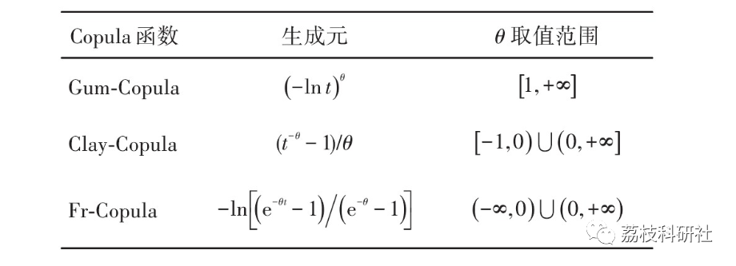
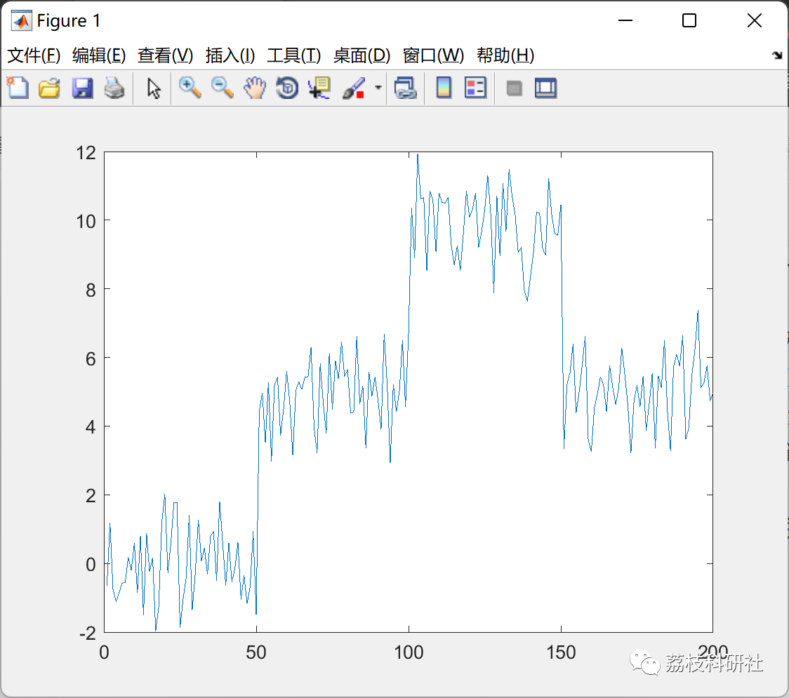
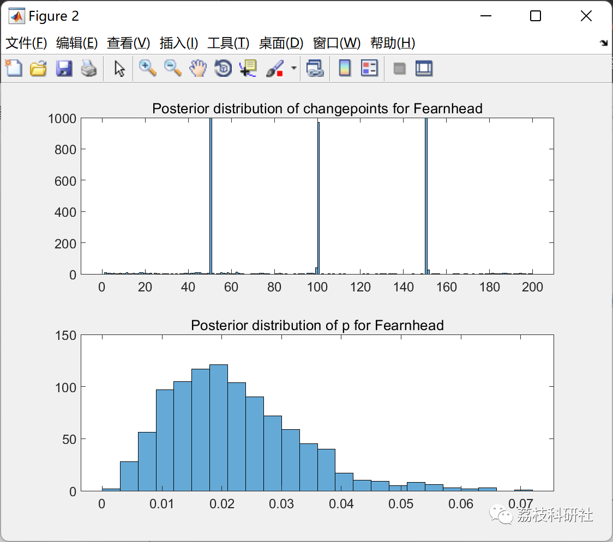
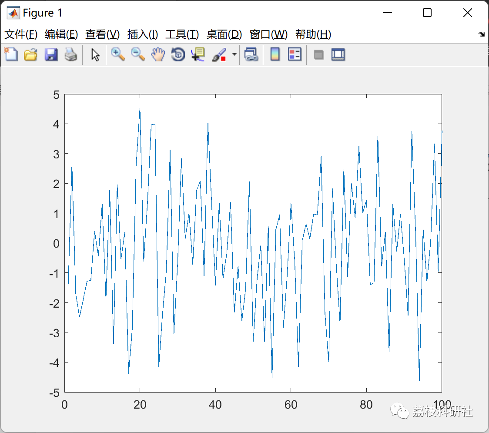
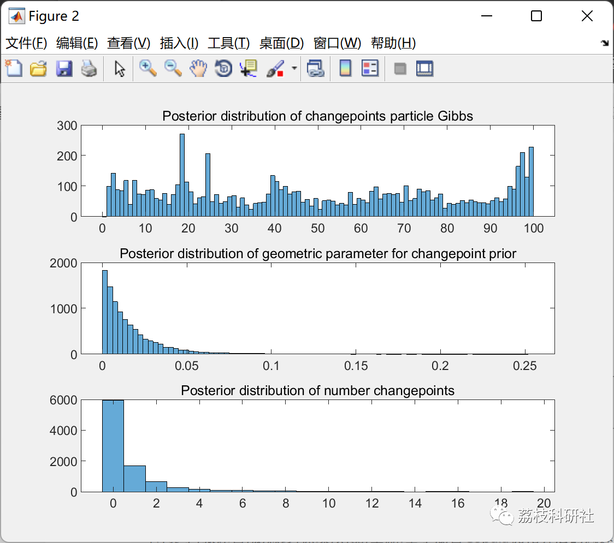
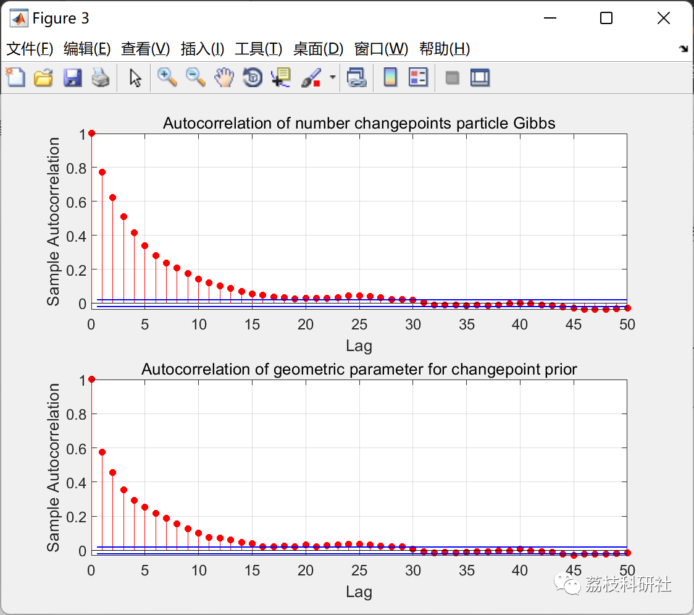

# Bayesian research in the optimization algorithm based on change point copula (Matlab code implementation)

💥💥💥💞💞💞💞 Welcome to this blog❤️❤️❤️💥💥💥
🏆 Bloggers' Advantage: 🌞🌞🌞 The content of the blog strives to be rigorous in thought and clear in logic, for the convenience of readers.
⛳️ Mantra: The journey of a hundred miles is half done in the last ninety.
Litchi Research Society
Code Collection: Power System, Intelligent Algorithms and Applications, Neural Network Prediction, Path Planning, Optimized Scheduling, Workshop Scheduling, Image Processing, Signal Processing...
🎁Column Directory Link:
🌈🌈🌈🌟🌟🌟Electrical Code Intelligent Algorithm and Its Application Path Planning Neural Network Predictive Optimization Scheduling Image Processing Workshop Scheduling Signal Processing Romantic Her My Philosophical Thoughts Math Modeling Complete Code Matters
Contents
💥1 Overview
1.1 Definition of Copula Function
1.2 Copula Function Types
📚2 Running Results
2.1 Scheme 1
2.2 Scheme 2
🎉3 References
🌈4 Matlab code implementation
💥1 Overview
1.1 Definition of Copula Function
The Copula was first proposed by Sklar in 1959, namely the Sklar Theorem.
Taking the bivariate variable as an example, F(x) and G(y) are respectively the marginal distribution functions of X and Y. According to equation (1), if H(x, y) is the joint distribution function of F(x) and G(y), then there exists a unique Copula function C that can connect the joint distribution function with the marginal distribution functions.
The Sklar theorem posits that the correlation properties of a joint distribution function are entirely determined by its Copula function. In other words, the randomness of variables can be described by their respective marginal distributions, while the coupling characteristics between variables need to be represented by a Copula function. The joint distribution of N random variables can be decomposed into N marginal distributions of the individual variables and a Copula function, which separates the randomness and coupling of variables, thereby reducing the difficulty of solving the joint distribution function.
1.2 Copula Function Types
Common Copula functions are divided into elliptical family Copula functions and Archimedean Copula functions. Elliptical family Copula functions include normal Copula functions and t-Copula functions, both of which have symmetric tail correlations and little difference in the central region. Archimedean Copula functions have a unified distribution function expression:

In the formula: u1,u2,...,UN——the marginal distribution of random variables; ()——the generating element of the Archimedean Copula function.

According to different generating elements, different Archimedean Copula functions can be obtained. Common ones include Frank Copula (Fr-Copula) function, Clayton Copula (Clay-Copula) function, and Gumbel Copula (Gum-Copula) function. The three types of Archimedean Copula generating elements are shown in Table 1.

Different types of Copula functions have different characteristics, so their descriptions of correlation are also different. Among them, elliptical family Copula functions and Fr-Copula functions focus on characterizing symmetric tail correlations, while Clay-Copula functions and Gum-Copula functions are more suitable for describing asymmetric upper tail characteristics and asymmetric lower tail characteristics. If only one type of Copula function is used for data fitting analysis of correlation, it may lead to distortion, resulting in an inaccurate analysis of correlation. Therefore, it is recommended to combine several Copula functions to construct mixed Copula function models for analyzing data correlation.
📚2 Run Results
2.1 Plan 1
2.2 Plan 2
🎉3 References
[1] Huang Yu, Zhang Bingzhe, Pang Huizhen, Xu Jing, Liu Lei, Wang Biao. Research on Wind Speed Forecasting Method Based on Mixed Copula Optimization Algorithm [J]. Solar Energy Science and Technology, 2022, 43(10): 192-201. DOI: 10.19912/j.0254-0096.tynxb.2021-0431.
🌈4 Matlab Code Implementation
Click the left bottom corner of the article to read more.

## Images

<!-- PAYMENT_BLOCK -->

## Get this dataset

- Payment link (Stripe): [Buy now](https://buy.stripe.com/3cs8yP7sY87d0vu9AB)
- Payment QR code: 

<!-- /PAYMENT_BLOCK -->
